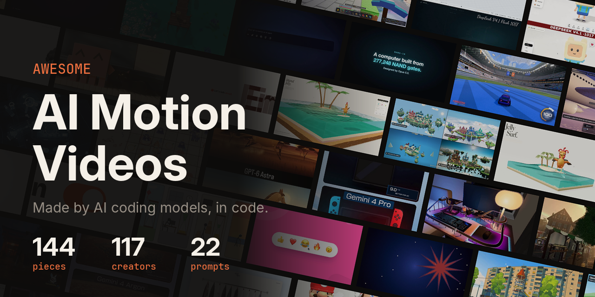

<!-- 由 scripts/build.mjs 根据 data/videos.json 生成，请改数据，不要直接改这里。 -->

# Awesome AI 动效视频合集

AI 编程模型用代码做出来的动效、发布片、3D 世界和小游戏，从 X 收集，附署名和提示词。

**167** 个作品 · **132** 位创作者 · **24** 附原始提示词 · 更新于 2026-10-30

[English](README.md) · 简体中文

**[▶ 用 Lookbk 上的技能，让你的 agent 也做出这样的视频](https://lookbk.dev/skills?utm_source=github&utm_medium=hero&utm_campaign=awesome-ai-motion-videos)**

自从 2026 年 9 月 22 日 Claude Opus 5.5 发布，大家开始让写代码的模型直接做动效、发布片、3D 世界和小游戏，产出的都是代码：three.js、canvas、SVG、Remotion 或 HyperFrames，再渲染成视频。这里收集了大家发在 X 上的优秀作品，新的在前，每条都署名原作者；作者公开了提示词的，原样附上。之后有新模型发布，也会继续收录。

[动效与发布片 (65)](#动效与发布片) · [3D 场景与世界 (26)](#3d-场景与世界) · [游戏与互动 (30)](#游戏与互动) · [模型对比 (46)](#模型对比)

收录的模型: Opus 5.5 (138) · GPT-6 Astra (20) · Gemini 4 Argon (20) · Sonnet 5.5 (11) · Kimi K3.1 Pro (8) · GPT-6.1 Sol (6) · Gemini 4 Pro (5) · DeepSeek V4.1 Flash (4) · GPT-6.1 Terra (3) · DeepSeek V4.1 Flash-1017 (3) · Opus 5 (3) · Kimi K3.1 (2) · Gemini 4 (2) · DeepSeek V4.1 (1) · DeepSeek V4 Flash (1) · Muse Wonder (1) · Fable 5.1 (1) · Haiku 5.5 (1) · Fable 5.5 (1) · Claude (1) · GPT 6.1 Sol (1) · Fable (1) · Gemini (1) · GPT-6 Sol (1) · GPT-6 Luna (1) · GPT-5.6 Sol (1) · GPT-5.6 Luna (1) · Grok 4.6 (1)

## 动效与发布片

<table>
<tr>
<td width="33%" valign="top"> <b><a href="https://x.com/kevin_t_ngo/status/2114815615156486362">蚂蚁爬过 Anthropic 的 S-1 招股书（画面与音乐全由代码生成）</a></b> <a href="https://x.com/kevin_t_ngo">@kevin_t_ngo</a> · 120s · Opus 5.5</td>
<td width="33%" valign="top"> <b><a href="https://x.com/superalesha/status/2113751620014002629">Kimi K3.1 Pro 给自己做发布片</a></b> <a href="https://x.com/superalesha">@superalesha</a> · 45s · Kimi K3.1 Pro</td>
<td width="33%" valign="top"> <b><a href="https://x.com/sundarpichai/status/2110059840957768027">从原始 CAD 文件在 Blender 中生成的 Pixel 手机爆炸视图动画</a></b> <a href="https://x.com/sundarpichai">@sundarpichai</a> · 19s · Gemini 4 Argon</td>
</tr>
<tr>
<td width="33%" valign="top"> <b><a href="https://x.com/chetaslua/status/2109244702235275680">人的一生，每一帧都用 JS 画</a></b> <a href="https://x.com/chetaslua">@chetaslua</a> · 30s · Opus 5.5</td>
<td width="33%" valign="top"> <b><a href="https://x.com/LexnLin/status/2108567673890111948">纸艺风格动画</a></b> <a href="https://x.com/LexnLin">@LexnLin</a> · 30s · Opus 5.5</td>
<td width="33%" valign="top"> <b><a href="https://x.com/flxrnc/status/2108242454105251921">Canvas 2D 绘制的 14 秒无缝 UI 动效循环</a></b> <a href="https://x.com/flxrnc">@flxrnc</a> · 14s · Opus 5.5 · <a href="prompts/2108242454105251921.md">提示词</a></td>
</tr>
<tr>
<td width="33%" valign="top"> <b><a href="https://x.com/kevin_t_ngo/status/2107462206610935857">用 JavaScript 画的自画像，配钢琴曲</a></b> <a href="https://x.com/kevin_t_ngo">@kevin_t_ngo</a> · 20s · Opus 5.5</td>
<td width="33%" valign="top"> <b><a href="https://x.com/LexnLin/status/2106101651010449796">Claude 给自己做广告</a></b> <a href="https://x.com/LexnLin">@LexnLin</a> · 15s · Opus 5.5</td>
<td width="33%" valign="top"> <b><a href="https://x.com/minchoi/status/2106027834217259394">一条提示词加音乐，12 小时后</a></b> <a href="https://x.com/minchoi">@minchoi</a> · 270s · Opus 5.5</td>
</tr>
<tr>
<td width="33%" valign="top"> <b><a href="https://x.com/ann_nnng/status/2106020945462984798">烫金压纹卡片</a></b> <a href="https://x.com/ann_nnng">@ann_nnng</a> · 25s · Opus 5.5</td>
<td width="33%" valign="top"> <b><a href="https://x.com/ivanainai/status/2105764877986099545">人类最大的骗局，无字动画</a></b> <a href="https://x.com/ivanainai">@ivanainai</a> · 15s · Opus 5.5</td>
<td width="33%" valign="top"> <b><a href="https://x.com/Miguel07Code/status/2105453292008661458">“深度即层级”：HyperFrames 做的 39 秒短片</a></b> <a href="https://x.com/Miguel07Code">@Miguel07Code</a> · 39s · Sonnet 5.5</td>
</tr>
<tr>
<td width="33%" valign="top"> <b><a href="https://x.com/ArchiveExplorer/status/2105023417716191488">不找代理公司的发布片和广告剪辑</a></b> <a href="https://x.com/ArchiveExplorer">@ArchiveExplorer</a> · 16s · Opus 5.5</td>
<td width="33%" valign="top"> <b><a href="https://x.com/sevdeawesome/status/2104985610012504181">回应“AI 只是普通技术”的视频</a></b> <a href="https://x.com/sevdeawesome">@sevdeawesome</a> · 317s · Opus 5.5</td>
<td width="33%" valign="top"> <b><a href="https://x.com/everestchris6/status/2104965415164399895">做高级动效视频的系统提示词</a></b> <a href="https://x.com/everestchris6">@everestchris6</a> · 40s · Opus 5.5 · <a href="prompts/2104965415164399895.md">提示词</a></td>
</tr>
<tr>
<td width="33%" valign="top"> <b><a href="https://x.com/DODOREACH/status/2104821709891404194">“不得不承认”的动效作品</a></b> <a href="https://x.com/DODOREACH">@DODOREACH</a> · 65s · Opus 5.5</td>
<td width="33%" valign="top"> <b><a href="https://x.com/uxmiles/status/2104618175803609305">三条提示词做的发布片</a></b> <a href="https://x.com/uxmiles">@uxmiles</a> · 15s · Opus 5.5</td>
<td width="33%" valign="top"> <b><a href="https://x.com/Voxyz_ai/status/2104586932357603600">/brag：读你的代码自动做发布片</a></b> <a href="https://x.com/Voxyz_ai">@Voxyz_ai</a> · 15s · Opus 5.5</td>
</tr>
<tr>
<td width="33%" valign="top"> <b><a href="https://x.com/TimGuignard/status/2104515756159623571">Opus 5.5 配 HyperFrames 的首测</a></b> <a href="https://x.com/TimGuignard">@TimGuignard</a> · 25s · Opus 5.5</td>
<td width="33%" valign="top"> <b><a href="https://x.com/emollick/status/2104402002868592659">用老科普节目风格讲 AI 的来路</a></b> <a href="https://x.com/emollick">@emollick</a> · 179s · Opus 5.5</td>
<td width="33%" valign="top"> <b><a href="https://x.com/gauravsbuilding/status/2104370091672711402">Ultracode 跑 12 小时做出的发布片</a></b> <a href="https://x.com/gauravsbuilding">@gauravsbuilding</a> · 15s · Opus 5.5</td>
</tr>
<tr>
<td width="33%" valign="top"> <b><a href="https://x.com/AIandDesign/status/2104285967251378494">给新公司做的宣传片，全是代码</a></b> <a href="https://x.com/AIandDesign">@AIandDesign</a> · 66s · Opus 5.5</td>
<td width="33%" valign="top"> <b><a href="https://x.com/ryan_morr/status/2104249941136666741">让作者惊呆的动效作品</a></b> <a href="https://x.com/ryan_morr">@ryan_morr</a> · 32s · Opus 5.5</td>
<td width="33%" valign="top"> <b><a href="https://x.com/farhanverse/status/2104249058239864853">Milo 产品片：CRT 办公室和 3D 运镜</a></b> <a href="https://x.com/farhanverse">@farhanverse</a> · 32s · Opus 5.5</td>
</tr>
<tr>
<td width="33%" valign="top"> <b><a href="https://x.com/martin_valchev_/status/2104248883018875074">给一个链接就做出带旁白的产品片</a></b> <a href="https://x.com/martin_valchev_">@martin_valchev_</a> · 124s · Opus 5.5</td>
<td width="33%" valign="top"> <b><a href="https://x.com/Justin_lords/status/2104248783349616951">儿童果冻动画</a></b> <a href="https://x.com/Justin_lords">@Justin_lords</a> · 134s · Opus 5.5</td>
<td width="33%" valign="top"> <b><a href="https://x.com/DDJCXX/status/2104222850383290427">13 分钟出片，配乐和返工都自己来</a></b> <a href="https://x.com/DDJCXX">@DDJCXX</a> · 15s · Opus 5.5</td>
</tr>
<tr>
<td width="33%" valign="top"> <b><a href="https://x.com/amos_gyamfi/status/2104216792877154656">184 个 SwiftUI 文字动画</a></b> <a href="https://x.com/amos_gyamfi">@amos_gyamfi</a> · 275s · Opus 5.5</td>
<td width="33%" valign="top"> <b><a href="https://x.com/kevin_t_ngo/status/2104213302624821647">每帧都用 JavaScript 画，带旁白</a></b> <a href="https://x.com/kevin_t_ngo">@kevin_t_ngo</a> · 80s · Opus 5.5 · Gemini</td>
<td width="33%" valign="top"> <b><a href="https://x.com/moguzbulbul/status/2104206095313215591">把 UX 决策做成面试用动画</a></b> <a href="https://x.com/moguzbulbul">@moguzbulbul</a> · 42s · Opus 5.5</td>
</tr>
<tr>
<td width="33%" valign="top"> <b><a href="https://x.com/Hesamation/status/2104200879637397978">为 Pink Floyd《Time》做的动画</a></b> <a href="https://x.com/Hesamation">@Hesamation</a> · 73s · Opus 5.5</td>
<td width="33%" valign="top"> <b><a href="https://x.com/achxvi/status/2104014659615392078">45 分钟做完</a></b> <a href="https://x.com/achxvi">@achxvi</a> · 39s · Opus 5.5</td>
<td width="33%" valign="top"> <b><a href="https://x.com/mattshumer_/status/2103928105320763818">完全用代码写出的动画短片</a></b> <a href="https://x.com/mattshumer_">@mattshumer_</a> · 193s · Opus 5.5</td>
</tr>
<tr>
<td width="33%" valign="top"> <b><a href="https://x.com/achxvi/status/2103918792845963545">15 分钟做完</a></b> <a href="https://x.com/achxvi">@achxvi</a> · 15s · Opus 5.5</td>
<td width="33%" valign="top"> <b><a href="https://x.com/theresanaiforit/status/2103908433581986254">用动效讲清楚提示词注入</a></b> <a href="https://x.com/theresanaiforit">@theresanaiforit</a> · 73s · Opus 5.5 · <a href="prompts/2103908433581986254.md">提示词</a></td>
<td width="33%" valign="top"> <b><a href="https://x.com/natiakourdadze/status/2103905465579061705">给 Diptell 做的“百万美元”发布片</a></b> <a href="https://x.com/natiakourdadze">@natiakourdadze</a> · 15s · Opus 5.5 · <a href="prompts/2103905465579061705.md">提示词</a></td>
</tr>
<tr>
<td width="33%" valign="top"> <b><a href="https://x.com/robj3d3/status/2103875898349088830">xhigh 档一次出片的作品集</a></b> <a href="https://x.com/robj3d3">@robj3d3</a> · 15s · Opus 5.5 · <a href="prompts/2103875898349088830.md">提示词</a></td>
<td width="33%" valign="top"> <b><a href="https://x.com/thermalpastor/status/2103842737032458567">它会回头把虚线手臂补上</a></b> <a href="https://x.com/thermalpastor">@thermalpastor</a> · 15s · Opus 5.5</td>
<td width="33%" valign="top"> <b><a href="https://x.com/eyishazyer/status/2103816865852129686">“作品集”提示词的又一版</a></b> <a href="https://x.com/eyishazyer">@eyishazyer</a> · 15s · Opus 5.5 · <a href="prompts/2103816865852129686.md">提示词</a></td>
</tr>
<tr>
<td width="33%" valign="top"> <b><a href="https://x.com/zaqailo/status/2103768009017835623">同一提示词，40 分钟稳定出片</a></b> <a href="https://x.com/zaqailo">@zaqailo</a> · 15s · Opus 5.5 · <a href="prompts/2103768009017835623.md">提示词</a></td>
<td width="33%" valign="top"> <b><a href="https://x.com/melvynx/status/2103714680577638493">10 分钟做完的 Lumail 发布片</a></b> <a href="https://x.com/melvynx">@melvynx</a> · 45s · Opus 5.5 · <a href="prompts/2103714680577638493.md">提示词</a></td>
<td width="33%" valign="top"> <b><a href="https://x.com/rexan_wong/status/2103707054108299437">“一条提示词”效果平平时，真正有用的做法</a></b> <a href="https://x.com/rexan_wong">@rexan_wong</a> · 11s · Opus 5.5</td>
</tr>
<tr>
<td width="33%" valign="top"> <b><a href="https://x.com/tdinh_me/status/2103703135902740699">原来花 1000 美元的视频，现在 30 分钟</a></b> <a href="https://x.com/tdinh_me">@tdinh_me</a> · 15s · Opus 5.5</td>
<td width="33%" valign="top"> <b><a href="https://x.com/jasonzhou1993/status/2103663364958515541">“作品集”提示词，第一次就成</a></b> <a href="https://x.com/jasonzhou1993">@jasonzhou1993</a> · 15s · Opus 5.5 · <a href="prompts/2103663364958515541.md">提示词</a></td>
<td width="33%" valign="top"> <b><a href="https://x.com/seflless/status/2103629182487929329">同一提示词的 Opus 5.5 Max 版本</a></b> <a href="https://x.com/seflless">@seflless</a> · 15s · Opus 5.5</td>
</tr>
<tr>
<td width="33%" valign="top"> <b><a href="https://x.com/leonabboud/status/2103576084499358051">一句话提示词做出的完整动效</a></b> <a href="https://x.com/leonabboud">@leonabboud</a> · 15s · Opus 5.5 · <a href="prompts/2103576084499358051.md">提示词</a></td>
<td width="33%" valign="top"> <b><a href="https://x.com/anabology/status/2103534482930491441">用 Donald 的提示词加情绪板，跑了 12 小时</a></b> <a href="https://x.com/anabology">@anabology</a> · 306s · Opus 5.5</td>
<td width="33%" valign="top"> <b><a href="https://x.com/himanshutwtxs/status/2103495232637882858">一条提示词的动效，开声音看</a></b> <a href="https://x.com/himanshutwtxs">@himanshutwtxs</a> · 15s · Opus 5.5</td>
</tr>
<tr>
<td width="33%" valign="top"> <b><a href="https://x.com/__morse/status/2103485566570369333">同一提示词换更多颜色，单个 index.html</a></b> <a href="https://x.com/__morse">@__morse</a> · 15s · Opus 5.5</td>
<td width="33%" valign="top"> <b><a href="https://x.com/verbove/status/2103483957266268381">零 After Effects 讲解 MakerMap</a></b> <a href="https://x.com/verbove">@verbove</a> · 20s · Opus 5.5</td>
<td width="33%" valign="top"> <b><a href="https://x.com/oozn/status/2103482545111232946">乔布斯一生的动画</a></b> <a href="https://x.com/oozn">@oozn</a> · 119s · Opus 5.5</td>
</tr>
<tr>
<td width="33%" valign="top"> <b><a href="https://x.com/shneural/status/2103472385563459833">把 Claude Code 会话做成 Blender 渲染短片</a></b> <a href="https://x.com/shneural">@shneural</a> · 56s · Opus 5.5</td>
<td width="33%" valign="top"> <b><a href="https://x.com/mablesjoseph/status/2103465246014746943">代码画出的 45 秒手绘短片</a></b> <a href="https://x.com/mablesjoseph">@mablesjoseph</a> · 46s · Opus 5.5</td>
<td width="33%" valign="top"> <b><a href="https://x.com/ajith_io/status/2103449416325890146">15 秒动效设计师作品集</a></b> <a href="https://x.com/ajith_io">@ajith_io</a> · 15s · Opus 5.5 · <a href="prompts/2103449416325890146.md">提示词</a></td>
</tr>
<tr>
<td width="33%" valign="top"> <b><a href="https://x.com/zheke/status/2103418664854622583">开放式提示下的动效设计展示</a></b> <a href="https://x.com/zheke">@zheke</a> · 15s · Opus 5.5 · <a href="prompts/2103418664854622583.md">提示词</a></td>
<td width="33%" valign="top"> <b><a href="https://x.com/Ishaaqahamed/status/2103374034943852667">一条提示词生成的带音效动效视频</a></b> <a href="https://x.com/Ishaaqahamed">@Ishaaqahamed</a> · 14s · Opus 5.5</td>
<td width="33%" valign="top"> <b><a href="https://x.com/kenn/status/2103337314021937232">xhigh 档单条提示词的动效</a></b> <a href="https://x.com/kenn">@kenn</a> · 15s · Opus 5.5</td>
</tr>
<tr>
<td width="33%" valign="top"> <b><a href="https://x.com/stephanlivera/status/2103315922098470926">“简历作品集”提示词，Max 档</a></b> <a href="https://x.com/stephanlivera">@stephanlivera</a> · 15s · Opus 5.5 · <a href="prompts/2103315922098470926.md">提示词</a></td>
<td width="33%" valign="top"> <b><a href="https://x.com/twoclipping/status/2103273003555402193">全代码动效，附模板</a></b> <a href="https://x.com/twoclipping">@twoclipping</a> · 14s · Opus 5.5</td>
<td width="33%" valign="top"> <b><a href="https://x.com/pleometric/status/2103082510607610023">按 Donald 的流程把模型推到极限</a></b> <a href="https://x.com/pleometric">@pleometric</a> · 157s · Opus 5.5</td>
</tr>
<tr>
<td width="33%" valign="top"> <b><a href="https://x.com/donaldjewkes/status/2102801274173587569">Claude Pop：一段口述提示词做出的 MV</a></b> <a href="https://x.com/donaldjewkes">@donaldjewkes</a> · 142s · Opus 5.5 · <a href="prompts/2102801274173587569.md">提示词</a></td>
<td width="33%" valign="top"> <b><a href="https://x.com/NFT_Chen/status/2102681172367323300">自己写剪辑软件再钻进去剪</a></b> <a href="https://x.com/NFT_Chen">@NFT_Chen</a> · 30s · Opus 5.5</td>
<td width="33%" valign="top"> <b><a href="https://x.com/pleometric/status/2102572941699354900">它的 TikTok 首页长什么样</a></b> <a href="https://x.com/pleometric">@pleometric</a> · 47s · Opus 5.5</td>
</tr>
<tr>
<td width="33%" valign="top"> <b><a href="https://x.com/Voxyz_ai/status/2102531681450119426">自己写故事、画每一帧、做音乐</a></b> <a href="https://x.com/Voxyz_ai">@Voxyz_ai</a> · 29s · Opus 5.5</td>
<td width="33%" valign="top"> <b><a href="https://x.com/other__reality/status/2102514581684052169">视觉设计短片</a></b> <a href="https://x.com/other__reality">@other__reality</a> · 157s · Opus 5.5</td>
<td width="33%"></td>
</tr>
</table>

想让你的 agent 也做出这种效果： <a href="https://lookbk.dev/skills/series/launch-films?utm_source=github&utm_medium=readme-motion&utm_campaign=awesome-ai-motion-videos">看 Lookbk 上的技能 →</a>

## 3D 场景与世界

<table>
<tr>
<td width="33%" valign="top"> <b><a href="https://x.com/maxt3chno/status/2115862732637458763">融合三个项目的 Three.js 写实水面着色器</a></b> <a href="https://x.com/maxt3chno">@maxt3chno</a> · 92s · Opus 5.5 · GPT-6 Astra</td>
<td width="33%" valign="top"> <b><a href="https://x.com/ash_twtz/status/2113323680940130668">Kimi K3.1 的 three.js 作品</a></b> <a href="https://x.com/ash_twtz">@ash_twtz</a> · 12s · Kimi K3.1</td>
<td width="33%" valign="top"> <b><a href="https://x.com/marcthecreatorr/status/2111401362713968942">DeepSeek V4.1 Flash 做的中世纪体素世界</a></b> <a href="https://x.com/marcthecreatorr">@marcthecreatorr</a> · 51s · DeepSeek V4.1 Flash-1017</td>
</tr>
<tr>
<td width="33%" valign="top"> <b><a href="https://x.com/jaimintf/status/2110086004808048950">同一提示词下最快的 Gemini 4 Argon</a></b> <a href="https://x.com/jaimintf">@jaimintf</a> · 14s · Gemini 4 Argon</td>
<td width="33%" valign="top"> <b><a href="https://x.com/chetaslua/status/2110050110784798950">用视觉自评循环搭出的宝塔</a></b> <a href="https://x.com/chetaslua">@chetaslua</a> · 45s · Gemini 4 Argon</td>
<td width="33%" valign="top"> <b><a href="https://x.com/genevieve__h/status/2110041611455353197">用照片重建的 3D 家庭办公室</a></b> <a href="https://x.com/genevieve__h">@genevieve__h</a> · 80s · Gemini 4 Argon</td>
</tr>
<tr>
<td width="33%" valign="top"> <b><a href="https://x.com/kickingkeys/status/2110037855452180633">这串帖子全是代码：Argon</a></b> <a href="https://x.com/kickingkeys">@kickingkeys</a> · 31s · Gemini 4 Argon</td>
<td width="33%" valign="top"> <b><a href="https://x.com/rewind02/status/2109661035036635291">在 Blender 里建模、绑骨、做动画</a></b> <a href="https://x.com/rewind02">@rewind02</a> · 47s · Opus 5.5</td>
<td width="33%" valign="top"> <b><a href="https://x.com/chetanankola/status/2108845317122900188">Petal Quay：Three.js 动漫风海岛与水面</a></b> <a href="https://x.com/chetanankola">@chetanankola</a> · 38s · Opus 5.5</td>
</tr>
<tr>
<td width="33%" valign="top"> <b><a href="https://x.com/maxt3chno/status/2107817159392989497">Chicken Joe 在果冻岛冲浪</a></b> <a href="https://x.com/maxt3chno">@maxt3chno</a> · 42s · Opus 5.5 · <a href="prompts/2107817159392989497.md">提示词</a></td>
<td width="33%" valign="top"> <b><a href="https://x.com/exploraX_/status/2107777623958917545">Three.js 阿拉伯宫殿 3D 网页体验</a></b> <a href="https://x.com/exploraX_">@exploraX_</a> · 150s · Opus 5.5</td>
<td width="33%" valign="top"> <b><a href="https://x.com/maxt3chno/status/2107578531593019644">果冻岛创意的 Astra 版本</a></b> <a href="https://x.com/maxt3chno">@maxt3chno</a> · 21s · GPT-6 Astra</td>
</tr>
<tr>
<td width="33%" valign="top"> <b><a href="https://x.com/ForkedPush/status/2106313584829431901">一周额度：Blender MCP 做的模型和动画</a></b> <a href="https://x.com/ForkedPush">@ForkedPush</a> · 162s · Opus 5.5</td>
<td width="33%" valign="top"> <b><a href="https://x.com/TimJayas/status/2106151100214825288">一条提示词生成的 Three.js 场景</a></b> <a href="https://x.com/TimJayas">@TimJayas</a> · 66s · Sonnet 5.5</td>
<td width="33%" valign="top"> <b><a href="https://x.com/techartist_/status/2106064200535859685">可交互的 3D 喷气发动机</a></b> <a href="https://x.com/techartist_">@techartist_</a> · 24s · Opus 5.5</td>
</tr>
<tr>
<td width="33%" valign="top"> <b><a href="https://x.com/xikhar/status/2105838937688400174">浏览器里的夜晚城市</a></b> <a href="https://x.com/xikhar">@xikhar</a> · 73s · Opus 5.5</td>
<td width="33%" valign="top"> <b><a href="https://x.com/mlperego/status/2105448230616023446">three.js 里的水</a></b> <a href="https://x.com/mlperego">@mlperego</a> · 76s · Claude</td>
<td width="33%" valign="top"> <b><a href="https://x.com/kevin_t_ngo/status/2105304249060274631">Python 写钢琴曲和 3D 动画，Blender 渲染</a></b> <a href="https://x.com/kevin_t_ngo">@kevin_t_ngo</a> · 72s · Opus 5.5</td>
</tr>
<tr>
<td width="33%" valign="top"> <b><a href="https://x.com/maxt3chno/status/2105216139647127750">零编程基础一个人做的 3D 世界</a></b> <a href="https://x.com/maxt3chno">@maxt3chno</a> · 161s · Opus 5.5</td>
<td width="33%" valign="top"> <b><a href="https://x.com/AmirMushich/status/2104676332601033144">可探索的童年苏式居民楼</a></b> <a href="https://x.com/AmirMushich">@AmirMushich</a> · 46s · Opus 5.5 · Sonnet 5.5</td>
<td width="33%" valign="top"> <b><a href="https://x.com/KanaWorks_AI/status/2104221517957783922">Godot 里的光照与氛围</a></b> <a href="https://x.com/KanaWorks_AI">@KanaWorks_AI</a> · 32s · Opus 5.5</td>
</tr>
<tr>
<td width="33%" valign="top"> <b><a href="https://x.com/prasenx/status/2104203568911966337">可以走进去的迈阿密海滩清晨</a></b> <a href="https://x.com/prasenx">@prasenx</a> · 283s · Opus 5.5</td>
<td width="33%" valign="top"> <b><a href="https://x.com/xikhar/status/2104001664793600012">Blender、生图和 three.js 合成的浏览器世界</a></b> <a href="https://x.com/xikhar">@xikhar</a> · 141s · Opus 5.5</td>
<td width="33%" valign="top"> <b><a href="https://x.com/AndreiProvkin/status/2103919236653428985">全程序化 Three.js 世界（含音效，零外部素材）</a></b> <a href="https://x.com/AndreiProvkin">@AndreiProvkin</a> · 68s · Opus 5.5</td>
</tr>
<tr>
<td width="33%" valign="top"> <b><a href="https://x.com/TimJayas/status/2103680718106947801">Gemini 4 Pro 做的机械蜂鸟</a></b> <a href="https://x.com/TimJayas">@TimJayas</a> · 48s · Gemini 4 Pro</td>
<td width="33%" valign="top"> <b><a href="https://x.com/majidmanzarpour/status/2103452506680393979">纯代码 Three.js 奔跑猎豹</a></b> <a href="https://x.com/majidmanzarpour">@majidmanzarpour</a> · 154s · Opus 5.5</td>
<td width="33%"></td>
</tr>
</table>

想让你的 agent 也做出这种效果： <a href="https://lookbk.dev/skills/series/motion-heroes?utm_source=github&utm_medium=readme-3d&utm_campaign=awesome-ai-motion-videos">看 Lookbk 上的技能 →</a>

## 游戏与互动

<table>
<tr>
<td width="33%" valign="top"> <b><a href="https://x.com/notjazii/status/2110059198230970782">Gemini 4 Argon 做的 Minecraft 克隆</a></b> <a href="https://x.com/notjazii">@notjazii</a> · 67s · Gemini 4 Argon</td>
<td width="33%" valign="top"> <b><a href="https://x.com/ai_for_success/status/2110040063656812976">可驾驶帆船的小岛场景（含水面物理）</a></b> <a href="https://x.com/ai_for_success">@ai_for_success</a> · 99s · Gemini 4 Argon</td>
<td width="33%" valign="top"> <b><a href="https://x.com/MengTo/status/2107445210011849103">把任意图标变成 3D 的工具</a></b> <a href="https://x.com/MengTo">@MengTo</a> · 57s · Opus 5.5</td>
</tr>
<tr>
<td width="33%" valign="top"> <b><a href="https://x.com/DilumSanjaya/status/2106426962738880879">像策略游戏一样的仓库管理软件</a></b> <a href="https://x.com/DilumSanjaya">@DilumSanjaya</a> · 72s · Opus 5.5</td>
<td width="33%" valign="top"> <b><a href="https://x.com/DannyLimanseta/status/2106072098993254792">雨中香港风城市送快递</a></b> <a href="https://x.com/DannyLimanseta">@DannyLimanseta</a> · 51s · Sonnet 5.5</td>
<td width="33%" valign="top"> <b><a href="https://x.com/bridgemindai/status/2106071883137392798">多人大逃杀游戏</a></b> <a href="https://x.com/bridgemindai">@bridgemindai</a> · 117s · Opus 5.5</td>
</tr>
<tr>
<td width="33%" valign="top"> <b><a href="https://x.com/kevin_t_ngo/status/2106015295223787709">有 10 个动画房间的小镇网站</a></b> <a href="https://x.com/kevin_t_ngo">@kevin_t_ngo</a> · 63s · Sonnet 5.5</td>
<td width="33%" valign="top"> <b><a href="https://x.com/Angaisb_/status/2105952417980592248">把 Minecraft 塞进 Slime Rancher</a></b> <a href="https://x.com/Angaisb_">@Angaisb_</a> · 107s · Opus 5.5</td>
<td width="33%" valign="top"> <b><a href="https://x.com/ZryMiller/status/2105730942753190165">Inkrunner：画出通往终点的路</a></b> <a href="https://x.com/ZryMiller">@ZryMiller</a> · 27s · Opus 5.5</td>
</tr>
<tr>
<td width="33%" valign="top"> <b><a href="https://x.com/Izkimar/status/2105533696296333544">给 MOBA 游戏设计的英雄</a></b> <a href="https://x.com/Izkimar">@Izkimar</a> · 48s · Opus 5.5</td>
<td width="33%" valign="top"> <b><a href="https://x.com/kevin_t_ngo/status/2105428751115071642">像纸上涂鸦的国际象棋</a></b> <a href="https://x.com/kevin_t_ngo">@kevin_t_ngo</a> · 74s · Sonnet 5.5</td>
<td width="33%" valign="top"> <b><a href="https://x.com/Rubzem/status/2105425742100341240">带银河战争的《无人深空》风游戏</a></b> <a href="https://x.com/Rubzem">@Rubzem</a> · 94s · Opus 5.5</td>
</tr>
<tr>
<td width="33%" valign="top"> <b><a href="https://x.com/AugustCastilIo/status/2105350465001029697">模型发布后做的第四个游戏</a></b> <a href="https://x.com/AugustCastilIo">@AugustCastilIo</a> · 46s · Opus 5.5</td>
<td width="33%" valign="top"> <b><a href="https://x.com/jshguo/status/2105250266392224097">WebGL 着色器里的齐白石虾</a></b> <a href="https://x.com/jshguo">@jshguo</a> · 10s · Opus 5.5</td>
<td width="33%" valign="top"> <b><a href="https://x.com/cambreedesigns/status/2104999693113766152">三条提示词做的作品集网站</a></b> <a href="https://x.com/cambreedesigns">@cambreedesigns</a> · 19s · Opus 5.5</td>
</tr>
<tr>
<td width="33%" valign="top"> <b><a href="https://x.com/p_e_cooper/status/2104980433972703483">经典 CoD 僵尸地图移植到网页</a></b> <a href="https://x.com/p_e_cooper">@p_e_cooper</a> · 37s · Opus 5.5 · GPT-6 Astra</td>
<td width="33%" valign="top"> <b><a href="https://x.com/AravSrinivas/status/2104941391272956125">Perplexity Computer 端到端做的开放世界游戏</a></b> <a href="https://x.com/AravSrinivas">@AravSrinivas</a> · 88s · Opus 5.5</td>
<td width="33%" valign="top"> <b><a href="https://x.com/BlendiByl/status/2104800823620632641">浏览器里的《火箭联盟》克隆</a></b> <a href="https://x.com/BlendiByl">@BlendiByl</a> · 39s · Opus 5.5</td>
</tr>
<tr>
<td width="33%" valign="top"> <b><a href="https://x.com/chrisfirst/status/2104644598626934858">浏览器里的《辐射：纽约》</a></b> <a href="https://x.com/chrisfirst">@chrisfirst</a> · 171s · Opus 5.5</td>
<td width="33%" valign="top"> <b><a href="https://x.com/mattshumer_/status/2104301990985498783">27.7 万个逻辑门搭出的电脑</a></b> <a href="https://x.com/mattshumer_">@mattshumer_</a> · 62s · Opus 5.5</td>
<td width="33%" valign="top"> <b><a href="https://x.com/kshvbgde/status/2104248546472132997">浏览器里的开放世界金刚狼游戏</a></b> <a href="https://x.com/kshvbgde">@kshvbgde</a> · 111s · Opus 5.5</td>
</tr>
<tr>
<td width="33%" valign="top"> <b><a href="https://x.com/jorge_coder/status/2104228372607881662">持续迭代的地牢游戏</a></b> <a href="https://x.com/jorge_coder">@jorge_coder</a> · 116s · Opus 5.5</td>
<td width="33%" valign="top"> <b><a href="https://x.com/AbhinavXJ/status/2104225686189994186">探索樱花谷并拍照</a></b> <a href="https://x.com/AbhinavXJ">@AbhinavXJ</a> · 176s · Opus 5.5</td>
<td width="33%" valign="top"> <b><a href="https://x.com/konstantinsaifo/status/2104216976801587629">可以拆开的核聚变反应堆</a></b> <a href="https://x.com/konstantinsaifo">@konstantinsaifo</a> · 43s · Opus 5.5</td>
</tr>
<tr>
<td width="33%" valign="top"> <b><a href="https://x.com/DannyLimanseta/status/2104215873120764032">和两个孩子一起做的塞尔达风游戏</a></b> <a href="https://x.com/DannyLimanseta">@DannyLimanseta</a> · 104s · Opus 5.5</td>
<td width="33%" valign="top"> <b><a href="https://x.com/didier_lopes/status/2104203064257228820">用声音指挥宝可梦对战</a></b> <a href="https://x.com/didier_lopes">@didier_lopes</a> · 86s · Opus 5.5</td>
<td width="33%" valign="top"> <b><a href="https://x.com/sonnylazuardi/status/2104202707309641862">three.js 立体机动巨人 Boss 战</a></b> <a href="https://x.com/sonnylazuardi">@sonnylazuardi</a> · 153s · Opus 5.5</td>
</tr>
<tr>
<td width="33%" valign="top"> <b><a href="https://x.com/webdevcody/status/2103653857377292720">管理 agent 的虚拟办公室</a></b> <a href="https://x.com/webdevcody">@webdevcody</a> · 42s · Opus 5.5</td>
<td width="33%" valign="top"> <b><a href="https://x.com/JaydenDavisNC/status/2103357848961036304">能玩的 Splatoon 风射击游戏</a></b> <a href="https://x.com/JaydenDavisNC">@JaydenDavisNC</a> · 148s · Opus 5.5</td>
<td width="33%" valign="top"> <b><a href="https://x.com/aipulseda1ly/status/2103352533657719230">Three.js 生存游戏：侵蚀地形海岛与 4.4 万棵程序化树木</a></b> <a href="https://x.com/aipulseda1ly">@aipulseda1ly</a> · 63s · Opus 5.5</td>
</tr>
</table>

想让你的 agent 也做出这种效果： <a href="https://lookbk.dev/skills?utm_source=github&utm_medium=readme-interactive&utm_campaign=awesome-ai-motion-videos">看 Lookbk 上的技能 →</a>

## 模型对比

<table>
<tr>
<td width="33%" valign="top"> <b><a href="https://x.com/luckeyfaraday/status/2115459494163402987">一句话生成 3D 米老鼠：Opus 5.5 对比 GPT-6.1 Terra</a></b> <a href="https://x.com/luckeyfaraday">@luckeyfaraday</a> · 12s · Opus 5.5 · GPT-6.1 Terra</td>
<td width="33%" valign="top"> <b><a href="https://x.com/marcthecreatorr/status/2115444940448702704">交互式 3D 超跑：GPT-6.1 Terra、Sonnet 5.5、GPT-6.1 Sol、Kimi K3.1 Pro 四模型对比</a></b> <a href="https://x.com/marcthecreatorr">@marcthecreatorr</a> · 24s · GPT-6.1 Terra · Sonnet 5.5 · GPT-6.1 Sol · Kimi K3.1 Pro</td>
<td width="33%" valign="top"> <b><a href="https://x.com/maxt3chno/status/2115029810850193444">Blender MCP 建模对比：GPT-6.1 Sol 对比 GPT-6.1 Terra</a></b> <a href="https://x.com/maxt3chno">@maxt3chno</a> · 15s · GPT-6.1 Sol · GPT-6.1 Terra</td>
</tr>
<tr>
<td width="33%" valign="top"> <b><a href="https://x.com/luckeyfaraday/status/2114405376703823873">3D 索尼克：DeepSeek 对 Opus</a></b> <a href="https://x.com/luckeyfaraday">@luckeyfaraday</a> · 24s · DeepSeek V4.1 Flash · Opus 5.5 · <a href="prompts/2114405376703823873.md">提示词</a></td>
<td width="33%" valign="top"> <b><a href="https://x.com/marcthecreatorr/status/2114074078340649183">浮空王国，四个模型</a></b> <a href="https://x.com/marcthecreatorr">@marcthecreatorr</a> · 67s · Opus 5.5 · DeepSeek V4.1 Flash-1017 · GPT-6 Astra · Kimi K3.1 Pro · <a href="prompts/2114074078340649183.md">提示词</a></td>
<td width="33%" valign="top"> <b><a href="https://x.com/the0xbt/status/2113996838818693507">新 Roadster 动画：Kimi 2 美元对 Opus 15 美元</a></b> <a href="https://x.com/the0xbt">@the0xbt</a> · 16s · Kimi K3.1 Pro · Opus 5.5</td>
</tr>
<tr>
<td width="33%" valign="top"> <b><a href="https://x.com/leohuanfang/status/2113986686237466871">雾山上的水墨龙，三个模型</a></b> <a href="https://x.com/leohuanfang">@leohuanfang</a> · 13s · Opus 5.5 · Gemini 4 Argon · DeepSeek V4.1</td>
<td width="33%" valign="top"> <b><a href="https://x.com/marcthecreatorr/status/2113910766781055052">可交互 3D 剖面房屋：Kimi 对 Astra</a></b> <a href="https://x.com/marcthecreatorr">@marcthecreatorr</a> · 38s · Kimi K3.1 · GPT-6 Astra · <a href="prompts/2113910766781055052.md">提示词</a></td>
<td width="33%" valign="top"> <b><a href="https://x.com/ItsmeAjayKV/status/2113868700545847697">Three.js 程序化灯塔场景：Kimi K3.1 Pro 对比 DeepSeek V4.1 Flash</a></b> <a href="https://x.com/ItsmeAjayKV">@ItsmeAjayKV</a> · 49s · Kimi K3.1 Pro · DeepSeek V4.1 Flash</td>
</tr>
<tr>
<td width="33%" valign="top"> <b><a href="https://x.com/yuhasbeentaken/status/2113717949811032357">秋日清晨的中央公园，四个模型</a></b> <a href="https://x.com/yuhasbeentaken">@yuhasbeentaken</a> · 30s · Opus 5.5 · Kimi K3.1 Pro · DeepSeek V4 Flash · GPT-6.1 Sol</td>
<td width="33%" valign="top"> <b><a href="https://x.com/AI_Screening/status/2113688082474221830">单文件 three.js：Kimi K3.1、Opus、Astra</a></b> <a href="https://x.com/AI_Screening">@AI_Screening</a> · 14s · Kimi K3.1 Pro · Opus 5.5 · GPT-6 Astra</td>
<td width="33%" valign="top"> <b><a href="https://x.com/adxtyahq/status/2113687234448875770">体素宝塔浮岛：Kimi K3.1 Pro 对比 Opus 5.5</a></b> <a href="https://x.com/adxtyahq">@adxtyahq</a> · 30s · Kimi K3.1 Pro · Opus 5.5</td>
</tr>
<tr>
<td width="33%" valign="top"> <b><a href="https://x.com/luckeyfaraday/status/2113456121721536723">便宜 7 倍的披萨：DeepSeek 对 Opus</a></b> <a href="https://x.com/luckeyfaraday">@luckeyfaraday</a> · 24s · DeepSeek V4.1 Flash · Opus 5.5</td>
<td width="33%" valign="top"> <b><a href="https://x.com/isagi1000x/status/2113206743484297681">交互式 3D 屋顶玻璃泳池：Opus 5.5 对比 Opus 5</a></b> <a href="https://x.com/isagi1000x">@isagi1000x</a> · 30s · Opus 5.5 · Opus 5</td>
<td width="33%" valign="top"> <b><a href="https://x.com/EnvolDev/status/2112995029337936362">灯塔测试，四个前沿模型</a></b> <a href="https://x.com/EnvolDev">@EnvolDev</a> · 25s · Gemini 4 Argon · Sonnet 5.5 · Opus 5.5 · GPT-6 Astra</td>
</tr>
<tr>
<td width="33%" valign="top"> <b><a href="https://x.com/aGim_asf/status/2112872797319856446">three.js 讲机翼升力：Opus 对 DeepSeek</a></b> <a href="https://x.com/aGim_asf">@aGim_asf</a> · 20s · Opus 5.5 · DeepSeek V4.1 Flash · <a href="prompts/2112872797319856446.md">提示词</a></td>
<td width="33%" valign="top"> <b><a href="https://x.com/noclipepe/status/2111858653456150974">地毯里钻出熔岩大象：Argon 对 Opus</a></b> <a href="https://x.com/noclipepe">@noclipepe</a> · 22s · Gemini 4 Argon · Opus 5.5</td>
<td width="33%" valign="top"> <b><a href="https://x.com/marcthecreatorr/status/2111427716142571554">Opus 5.5 对 DeepSeek V4.1 Flash</a></b> <a href="https://x.com/marcthecreatorr">@marcthecreatorr</a> · 57s · Opus 5.5 · DeepSeek V4.1 Flash-1017</td>
</tr>
<tr>
<td width="33%" valign="top"> <b><a href="https://x.com/shownotover/status/2111369408354439554">外星人把汉堡店搬回家：Argon 对 Opus</a></b> <a href="https://x.com/shownotover">@shownotover</a> · 15s · Gemini 4 Argon · Opus 5.5</td>
<td width="33%" valign="top"> <b><a href="https://x.com/yuhasbeentaken/status/2110777762277654749">把海绵宝宝编程对决拍成办公室剧</a></b> <a href="https://x.com/yuhasbeentaken">@yuhasbeentaken</a> · 30s · Gemini 4 Argon · Opus 5.5 · <a href="prompts/2110777762277654749.md">提示词</a></td>
<td width="33%" valign="top"> <b><a href="https://x.com/Offloop/status/2110763712424690134">Argon 对 Opus：5 倍时间、8 倍成本</a></b> <a href="https://x.com/Offloop">@Offloop</a> · 30s · Gemini 4 Argon · Opus 5.5</td>
</tr>
<tr>
<td width="33%" valign="top"> <b><a href="https://x.com/AdityaJhajhar12/status/2110223026549850196">Opus 5.5、Argon、Sol、Astra 四方对比</a></b> <a href="https://x.com/AdityaJhajhar12">@AdityaJhajhar12</a> · 30s · Opus 5.5 · Gemini 4 Argon · GPT-6.1 Sol · GPT-6 Astra</td>
<td width="33%" valign="top"> <b><a href="https://x.com/patch_gg/status/2110150043596681673">同一游戏提示词：Gemini 4 Argon 对比 Muse Wonder</a></b> <a href="https://x.com/patch_gg">@patch_gg</a> · 25s · Gemini 4 Argon · Muse Wonder</td>
<td width="33%" valign="top"> <b><a href="https://x.com/luckeyfaraday/status/2110087305163854042">马里奥 3D 测试：Argon 对 Opus</a></b> <a href="https://x.com/luckeyfaraday">@luckeyfaraday</a> · 24s · Gemini 4 Argon · Opus 5.5</td>
</tr>
<tr>
<td width="33%" valign="top"> <b><a href="https://x.com/notjazii/status/2110073240404271335">最高推理档的 Opus 5.5 对 Gemini 4 Argon</a></b> <a href="https://x.com/notjazii">@notjazii</a> · Opus 5.5 · Gemini 4 Argon</td>
<td width="33%" valign="top"> <b><a href="https://x.com/rubenssoto_ai/status/2110065587279798719">3D 讲解电机原理：Opus 对 Argon</a></b> <a href="https://x.com/rubenssoto_ai">@rubenssoto_ai</a> · 40s · Opus 5.5 · Gemini 4 Argon</td>
<td width="33%" valign="top"> <b><a href="https://x.com/Adidotdev/status/2110047989280670072">果冻岛提示词：Argon 对 Opus</a></b> <a href="https://x.com/Adidotdev">@Adidotdev</a> · 41s · Gemini 4 Argon · Opus 5.5 · <a href="prompts/2110047989280670072.md">提示词</a></td>
</tr>
<tr>
<td width="33%" valign="top"> <b><a href="https://x.com/Adidotdev/status/2110043897812668840">SVG 动画：Argon 对 Astra</a></b> <a href="https://x.com/Adidotdev">@Adidotdev</a> · 28s · Gemini 4 Argon · GPT-6 Astra</td>
<td width="33%" valign="top"> <b><a href="https://x.com/rewind02/status/2109953507801313440">Opus 5.5 对 Astra，在 Blender 里建模</a></b> <a href="https://x.com/rewind02">@rewind02</a> · 14s · Opus 5.5 · GPT-6 Astra</td>
<td width="33%" valign="top"> <b><a href="https://x.com/Thusatharan/status/2108511286795640926">四个 Claude 模型做程序化 3D 大象</a></b> <a href="https://x.com/Thusatharan">@Thusatharan</a> · 44s · Fable 5.1 · Opus 5.5 · Haiku 5.5 · Sonnet 5.5</td>
</tr>
<tr>
<td width="33%" valign="top"> <b><a href="https://x.com/motion_so/status/2107507518817878117">有无 harness 的发布片对比</a></b> <a href="https://x.com/motion_so">@motion_so</a> · 20s · Opus 5.5 · <a href="prompts/2107507518817878117.md">提示词</a></td>
<td width="33%" valign="top"> <b><a href="https://x.com/luckeyfaraday/status/2106558072370196921">四个模型的马里奥测试</a></b> <a href="https://x.com/luckeyfaraday">@luckeyfaraday</a> · 19s · GPT-6 Astra · GPT-6.1 Sol · Sonnet 5.5 · Opus 5.5</td>
<td width="33%" valign="top"> <b><a href="https://x.com/viktoroddy/status/2106324239121100905">GPT-6 Astra 对 Opus 5.5，同一提示词</a></b> <a href="https://x.com/viktoroddy">@viktoroddy</a> · 8s · GPT-6 Astra · Opus 5.5</td>
</tr>
<tr>
<td width="33%" valign="top"> <b><a href="https://x.com/mesmerlord/status/2105758042830549235">Fable 5.5 早期效果对比 Opus 5.5</a></b> <a href="https://x.com/mesmerlord">@mesmerlord</a> · 15s · Fable 5.5 · Opus 5.5</td>
<td width="33%" valign="top"> <b><a href="https://x.com/DanielZambrini/status/2105756266211729596">四个模型，同一个代码动画</a></b> <a href="https://x.com/DanielZambrini">@DanielZambrini</a> · 66s · GPT-6.1 Sol · GPT-6 Astra · Sonnet 5.5 · Opus 5.5</td>
<td width="33%" valign="top"> <b><a href="https://x.com/JakubAntowski/status/2105245039521628213">Three.js 交互式毛毡角色：GPT 6.1 Sol 对比 Opus 5.5</a></b> <a href="https://x.com/JakubAntowski">@JakubAntowski</a> · 20s · GPT 6.1 Sol · Opus 5.5</td>
</tr>
<tr>
<td width="33%" valign="top"> <b><a href="https://x.com/rewind02/status/2104513088565150027">Opus 5.5 对 Astra 做 3D：各自擅长什么</a></b> <a href="https://x.com/rewind02">@rewind02</a> · 25s · Opus 5.5 · GPT-6 Astra</td>
<td width="33%" valign="top"> <b><a href="https://x.com/charliejhills/status/2104500966389399716">Opus 5.5、Astra、Fable 同题“全力以赴”</a></b> <a href="https://x.com/charliejhills">@charliejhills</a> · 12s · Opus 5.5 · GPT-6 Astra · Fable</td>
<td width="33%" valign="top"> <b><a href="https://x.com/GodsBoy7777/status/2104179308101005594">六个模型画鹈鹕 SVG</a></b> <a href="https://x.com/GodsBoy7777">@GodsBoy7777</a> · 24s · Opus 5.5 · GPT-6 Astra · GPT-6 Sol · GPT-6 Luna · GPT-5.6 Sol · GPT-5.6 Luna · <a href="prompts/2104179308101005594.md">提示词</a></td>
</tr>
<tr>
<td width="33%" valign="top"> <b><a href="https://x.com/AI_Screening/status/2103844997300945176">Arena 里的 Gemini 4 Pro 对 Astra max</a></b> <a href="https://x.com/AI_Screening">@AI_Screening</a> · 15s · Gemini 4 Pro · GPT-6 Astra</td>
<td width="33%" valign="top"> <b><a href="https://x.com/HarshithLucky3/status/2103821120009048245">Gemini 4 Pro 新版本对 Opus 5.5 High</a></b> <a href="https://x.com/HarshithLucky3">@HarshithLucky3</a> · 45s · Gemini 4 Pro · Opus 5.5</td>
<td width="33%" valign="top"> <b><a href="https://x.com/AI_Screening/status/2103507872621691101">相隔一周的两个 Gemini 4 版本</a></b> <a href="https://x.com/AI_Screening">@AI_Screening</a> · 26s · Gemini 4</td>
</tr>
<tr>
<td width="33%" valign="top"> <b><a href="https://x.com/shneural/status/2103151003272962130">引爆一切的“简历作品集”提示词：Opus 5.5 对 GPT-6 Astra</a></b> <a href="https://x.com/shneural">@shneural</a> · 32s · Opus 5.5 · GPT-6 Astra · <a href="prompts/2103151003272962130.md">提示词</a></td>
<td width="33%" valign="top"> <b><a href="https://x.com/thtbee_/status/2101445480651911477">机械蝴蝶：Gemini 4 Pro 对 Astra</a></b> <a href="https://x.com/thtbee_">@thtbee_</a> · 27s · Gemini 4 Pro · GPT-6 Astra</td>
<td width="33%" valign="top"> <b><a href="https://x.com/CodeByPoonam/status/2101294798573629532">补完一幅画：四个模型</a></b> <a href="https://x.com/CodeByPoonam">@CodeByPoonam</a> · 20s · Opus 5 · Gemini 4 · GPT-6 Astra · Grok 4.6</td>
</tr>
<tr>
<td width="33%" valign="top"> <b><a href="https://x.com/noclipepe/status/2100939999822631409">Opus 5 对 Gemini 4 Pro，一次成</a></b> <a href="https://x.com/noclipepe">@noclipepe</a> · 13s · Opus 5 · Gemini 4 Pro</td>
<td width="33%"></td>
<td width="33%"></td>
</tr>
</table>

想让你的 agent 也做出这种效果： <a href="https://lookbk.dev/skills?utm_source=github&utm_medium=readme-comparison&utm_campaign=awesome-ai-motion-videos">看 Lookbk 上的技能 →</a>

## 可以直接用的提示词

这些提示词是作者随作品公开的。每页都原样引用，并链接到作者发布的位置。

| 作品 | 作者 | 模型 |
| --- | --- | --- |
| [3D 索尼克：DeepSeek 对 Opus](prompts/2114405376703823873.md) | [@luckeyfaraday](https://x.com/luckeyfaraday/status/2114405376703823873) | DeepSeek V4.1 Flash · Opus 5.5 |
| [浮空王国，四个模型](prompts/2114074078340649183.md) | [@marcthecreatorr](https://x.com/marcthecreatorr/status/2114074078340649183) | Opus 5.5 · DeepSeek V4.1 Flash-1017 · GPT-6 Astra · Kimi K3.1 Pro |
| [可交互 3D 剖面房屋：Kimi 对 Astra](prompts/2113910766781055052.md) | [@marcthecreatorr](https://x.com/marcthecreatorr/status/2113910766781055052) | Kimi K3.1 · GPT-6 Astra |
| [three.js 讲机翼升力：Opus 对 DeepSeek](prompts/2112872797319856446.md) | [@aGim_asf](https://x.com/aGim_asf/status/2112872797319856446) | Opus 5.5 · DeepSeek V4.1 Flash |
| [把海绵宝宝编程对决拍成办公室剧](prompts/2110777762277654749.md) | [@yuhasbeentaken](https://x.com/yuhasbeentaken/status/2110777762277654749) | Gemini 4 Argon · Opus 5.5 |
| [果冻岛提示词：Argon 对 Opus](prompts/2110047989280670072.md) | [@Adidotdev](https://x.com/Adidotdev/status/2110047989280670072) | Gemini 4 Argon · Opus 5.5 |
| [Canvas 2D 绘制的 14 秒无缝 UI 动效循环](prompts/2108242454105251921.md) | [@flxrnc](https://x.com/flxrnc/status/2108242454105251921) | Opus 5.5 |
| [Chicken Joe 在果冻岛冲浪](prompts/2107817159392989497.md) | [@maxt3chno](https://x.com/maxt3chno/status/2107817159392989497) | Opus 5.5 |
| [有无 harness 的发布片对比](prompts/2107507518817878117.md) | [@motion_so](https://x.com/motion_so/status/2107507518817878117) | Opus 5.5 |
| [做高级动效视频的系统提示词](prompts/2104965415164399895.md) | [@everestchris6](https://x.com/everestchris6/status/2104965415164399895) | Opus 5.5 |
| [六个模型画鹈鹕 SVG](prompts/2104179308101005594.md) | [@GodsBoy7777](https://x.com/GodsBoy7777/status/2104179308101005594) | Opus 5.5 · GPT-6 Astra · GPT-6 Sol · GPT-6 Luna · GPT-5.6 Sol · GPT-5.6 Luna |
| [用动效讲清楚提示词注入](prompts/2103908433581986254.md) | [@theresanaiforit](https://x.com/theresanaiforit/status/2103908433581986254) | Opus 5.5 |
| [给 Diptell 做的“百万美元”发布片](prompts/2103905465579061705.md) | [@natiakourdadze](https://x.com/natiakourdadze/status/2103905465579061705) | Opus 5.5 |
| [xhigh 档一次出片的作品集](prompts/2103875898349088830.md) | [@robj3d3](https://x.com/robj3d3/status/2103875898349088830) | Opus 5.5 |
| [“作品集”提示词的又一版](prompts/2103816865852129686.md) | [@eyishazyer](https://x.com/eyishazyer/status/2103816865852129686) | Opus 5.5 |
| [同一提示词，40 分钟稳定出片](prompts/2103768009017835623.md) | [@zaqailo](https://x.com/zaqailo/status/2103768009017835623) | Opus 5.5 |
| [10 分钟做完的 Lumail 发布片](prompts/2103714680577638493.md) | [@melvynx](https://x.com/melvynx/status/2103714680577638493) | Opus 5.5 |
| [“作品集”提示词，第一次就成](prompts/2103663364958515541.md) | [@jasonzhou1993](https://x.com/jasonzhou1993/status/2103663364958515541) | Opus 5.5 |
| [一句话提示词做出的完整动效](prompts/2103576084499358051.md) | [@leonabboud](https://x.com/leonabboud/status/2103576084499358051) | Opus 5.5 |
| [15 秒动效设计师作品集](prompts/2103449416325890146.md) | [@ajith_io](https://x.com/ajith_io/status/2103449416325890146) | Opus 5.5 |
| [开放式提示下的动效设计展示](prompts/2103418664854622583.md) | [@zheke](https://x.com/zheke/status/2103418664854622583) | Opus 5.5 |
| [“简历作品集”提示词，Max 档](prompts/2103315922098470926.md) | [@stephanlivera](https://x.com/stephanlivera/status/2103315922098470926) | Opus 5.5 |
| [引爆一切的“简历作品集”提示词：Opus 5.5 对 GPT-6 Astra](prompts/2103151003272962130.md) | [@shneural](https://x.com/shneural/status/2103151003272962130) | Opus 5.5 · GPT-6 Astra |
| [Claude Pop：一段口述提示词做出的 MV](prompts/2102801274173587569.md) | [@donaldjewkes](https://x.com/donaldjewkes/status/2102801274173587569) | Opus 5.5 |

## 投稿

看到或做了适合收录的作品？[提交一条](https://github.com/SHARPLEE00/awesome-ai-motion-videos/issues/new?template=submit.yml)，附上原帖链接。我们收录主要由 AI 模型完成的作品，署名作者并链接原帖。详见 [CONTRIBUTING.md](CONTRIBUTING.md)。

## 署名与版权

所有视频、提示词和引用的帖子文字都归原作者所有。本仓库只链接原帖，缩略图直接引用 X 自己的图片地址，不复制、不转存任何人的视频。MIT 许可只覆盖本仓库自己的脚本和结构。使用的模型以作者自述为准。需要更正署名或删除条目，见 [MEDIA-RIGHTS.md](MEDIA-RIGHTS.md)。

与 Anthropic、Moonshot AI、OpenAI、Google 均无关联。维护者： [Lookbk](https://lookbk.dev/?utm_source=github&utm_medium=footer&utm_campaign=awesome-ai-motion-videos) · 做视频、幻灯片、图片和网页的 agent 技能.
